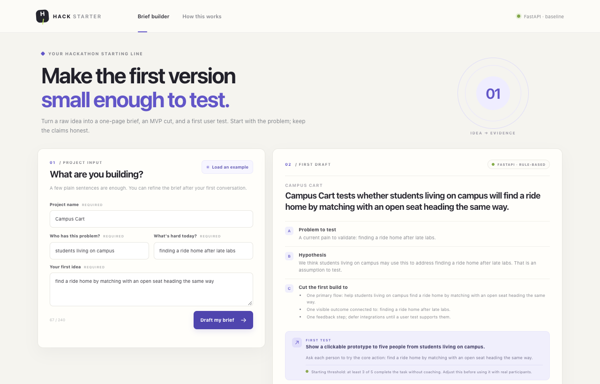

# Hack Starter

A small, reusable hackathon starting point: a FastAPI app, a static fallback demo, a reproducible smoke evaluation, a live API demo script, and a checklist for keeping claims honest.

The example product is a one-page **problem brief builder**. It turns four inputs into a testable MVP cut and a first user-test plan. The included baseline is deliberately deterministic: it makes no model calls and searches no external sources. Replace `app/core.py` with your project's real behavior, while keeping the API and fallback contract clear.



*The running app with the demo payload. The draft is generated by a deterministic template, not a model, and the page says so.*

## Start fast

Requires Python 3.11 or newer.

```bash
python3 -m venv .venv
source .venv/bin/activate
python -m pip install -e '.[dev]'
python -m uvicorn app.main:app --reload --host 127.0.0.1 --port 8000
```

Open <http://127.0.0.1:8000>. The interactive API schema is at <http://127.0.0.1:8000/docs>.

## Demo modes

**FastAPI mode** serves the browser UI and `POST /api/brief` from one origin. It returns a structured brief and says `model_used: false`.

**Static fallback mode** is useful when the backend or a model provider is unavailable:

```bash
python3 -m http.server 8766 --directory web
```

Open <http://127.0.0.1:8766>. The form still works in the browser with the same deterministic baseline. The page labels this as `Static fallback · offline`; it does not pretend an API call succeeded.

Run the short API demo from a second terminal (it uses `.venv` if present, and tells you what to install if not):

```bash
./scripts/demo.sh
```

It starts Uvicorn on `127.0.0.1:8765`, checks health, sends `scripts/demo_payload.json`, prints the JSON response, and stops the server. Set `HACK_STARTER_PORT` to use another available port.

## Tests and evaluation

```bash
python -m pytest -q
python scripts/evaluate.py
./scripts/check.sh
```

The tests cover API validation, response shape, static serving, the explicit no-model disclosure, and that the browser fallback (`web/app.js`) produces exactly the same brief as the Python builder (that test needs Node and is skipped without it). The five-case evaluation is a smoke check that can fail only if a field is dropped or the template stops carrying the input through, so a 100% result says little. It checks that the draft has its expected sections and retains the submitted input fragments. It reports structure and input-retention rates; it does **not** measure helpfulness, factual accuracy, user value, or demand. The cases are small developer-authored fixtures, not an independent benchmark.

GitHub Actions runs the compile check, tests, and smoke evaluation on Python 3.11, 3.12 and 3.14.

## Project layout

```text
app/                 FastAPI endpoints and the baseline brief function
web/                 Static UI; works with or without the backend
tests/               API and core behavior tests
eval/cases.json      Small, visible evaluation fixtures
scripts/demo.sh      Start API, send sample request, print result, stop API
scripts/evaluate.py  Structure and input-retention smoke evaluation
HONESTY_CHECKLIST.md Demo, evidence, evaluation, privacy, and claim review
```

## Before you fork it for a real project

1. Replace the example brief builder with the smallest real user workflow.
2. Keep one request/response contract shared by the backend and static fallback.
3. Add a small fixture set before model or product changes, then describe what it can and cannot tell you.
4. Add credentials only on the server, through environment variables; do not commit `.env` files or place keys in browser code.
5. Review [HONESTY_CHECKLIST.md](HONESTY_CHECKLIST.md) before recording or submitting.

The starter has no database, sign-in, model provider, or third-party service. User submissions stay in the browser/API request and are not persisted. Add authentication and a data-retention plan before deploying a version that stores or exposes participant data.

## License

MIT. The brief builder exists twice (`app/core.py` and `makeLocalBrief` in `web/app.js`); change both and run the tests.
